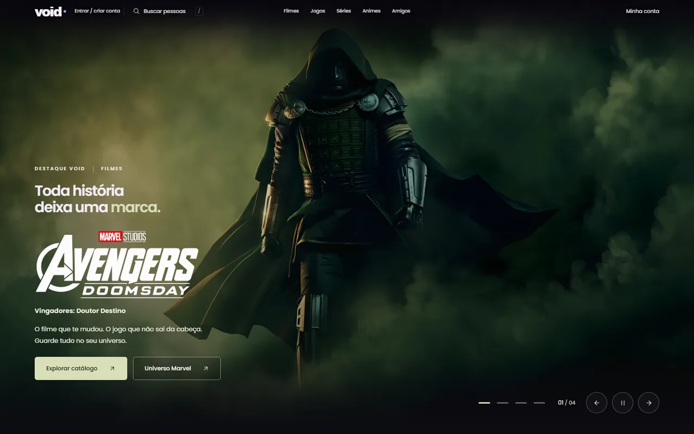
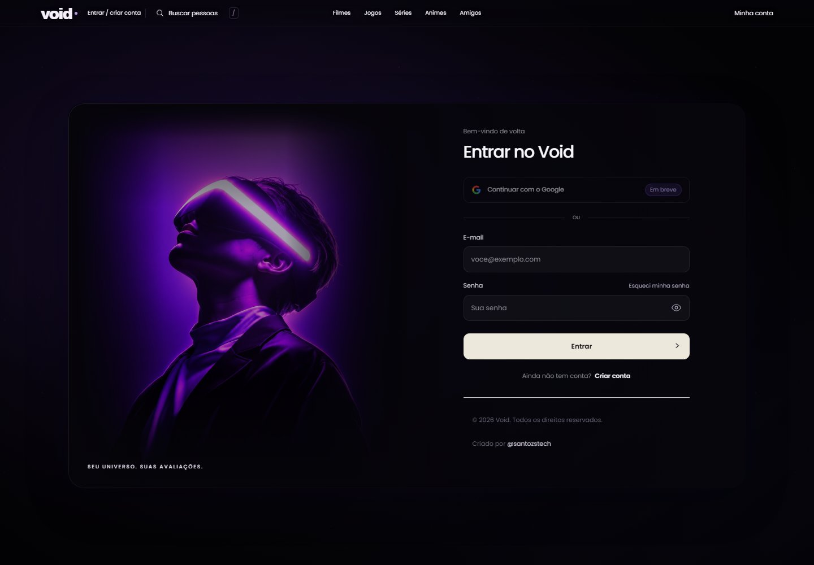
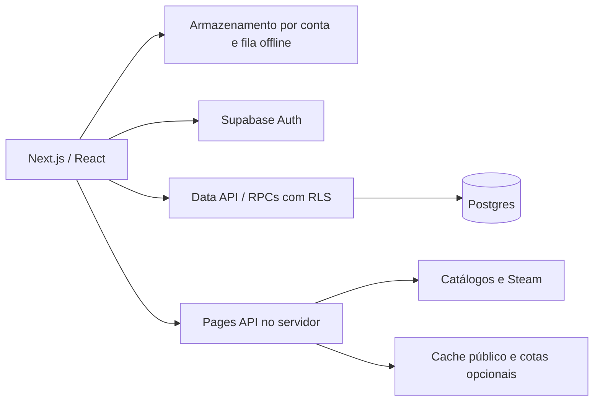

<div align="center">


**Uma plataforma social para descobrir, organizar e avaliar filmes, séries, animes e jogos.**

[Demonstração](https://void-lake-ten.vercel.app) · [Instalação](#executar-localmente) · [Arquitetura](#arquitetura)


</div>

O VOID reúne catálogos de cultura pop, registros pessoais e conexões entre pessoas. A experiência combina descoberta visual, organização por mídia, avaliações e listas colaborativas, com controle de visibilidade por recurso.



<details>
<summary>Tela de acesso</summary>



</details>

As capturas mostram a interface real. A demonstração hospedada e esta cópia de código podem estar em versões diferentes.

## Funcionalidades implementadas

| Descobrir | Organizar | Participar |
| --- | --- | --- |
| Catálogos de filmes, séries, animes e jogos | Avaliações de 0 a 5, com uma casa decimal | Perfis, seguidores, amizades e bloqueios |
| Pesquisa, destaques e universos de franquias | Favoritos, watchlists e biblioteca de jogos | Listas colaborativas com aceite de convites |
| Detalhes, episódios, temporadas e recomendações | Listas personalizadas e progresso | Comentários, reações e notificações |
| Artes e metadados de provedores especializados | Registro local para visitantes e sincronização por conta | Cards de avaliações para compartilhar |

A integração **Steam** permite vincular uma conta, importar jogos com atividade comprovada e acompanhar conquistas disponíveis. O vínculo usa OpenID e não oferece login no VOID. Importação, biblioteca manual e avaliações são recursos independentes; limitações e privacidade da Steam podem impedir a leitura de alguns dados.

## Tecnologias

- Next.js 15 com Pages Router, React 18 e JavaScript ESM.
- CSS próprio, fontes locais Poppins e Press Start 2P via Fontsource.
- Supabase Auth, Postgres, RLS, Storage e uma Edge Function de verificação opcional de e-mail.
- TMDB, IGDB/Twitch, Jikan-Edge/MyAnimeList, AniList e Steam; Fanart.tv opcional e RAWG no modo legado explícito.
- Sharp e renderização de cards no servidor; QRCode para convites.
- Node Test Runner, PostgreSQL isolado com PGlite, ESLint, Prettier e checkJs/JSDoc em módulos críticos selecionados.

## Arquitetura



O navegador recebe somente a URL e a chave pública do Supabase. Segredos dos catálogos e operações privilegiadas ficam no servidor. RLS controla o acesso a dados por propriedade, visibilidade e participação. Caches de catálogo são separados dos registros privados.

```text
pages/          Páginas e APIs do servidor
components/     Interface compartilhada e componentes por domínio
lib/            Integrações, modelos, hooks, cache e sincronização
styles/         Estilos por funcionalidade
config/         Curadoria e configuração editorial
public/         Assets da interface
supabase/       Migrations, Edge Function e testes SQL
tests/          Testes automatizados com dados sintéticos
scripts/        Ferramentas e executores de validação
docs/           Guias públicos, créditos e screenshots
```

## Executar localmente

Requer Node.js **22.13 ou superior** e npm. Use uma cópia deste repositório e um projeto Supabase separado para desenvolvimento.

```sh
npm ci --ignore-scripts
```

Copie `.env.example` para `.env.local` e configure as integrações desejadas. No PowerShell:

```powershell
Copy-Item .env.example .env.local
npm.cmd run dev
```

Em outros terminais, use `cp .env.example .env.local` e `npm run dev`. Abra `http://localhost:3000`.

O [guia de ambiente](docs/ENVIRONMENT.md) explica as variáveis, o banco e as APIs. Sem chaves de catálogo, a interface informa indisponibilidade; não gera notas nem dados sociais fictícios. Sem Supabase configurado, os recursos remotos não ficam disponíveis.

Para produção local:

```sh
npm run build
npm start
```

## Validação

```sh
npm run lint
npm run typecheck
npm run format:check
npm test
npm run test:sql
npm run build
npm audit
npm run check:worktree
```

`typecheck` cobre quatro módulos críticos com JSDoc/checkJs, sem migração para TypeScript. O Prettier também tem escopo incremental. Os testes SQL usam PGlite em memória, Auth/Storage simulados e dados sintéticos: não acessam Supabase remoto. Testes de navegador e sua configuração estão em [TESTING.md](docs/TESTING.md).

## Roadmap de manutenção

- Ampliar gradualmente contratos JSDoc e cobertura dos fluxos de autenticação/sincronização.
- Validar integrações e isolamento em homologação independente.
- Completar ensaios de recuperação e atendimento de exportação/exclusão de dados.
- Evoluir observabilidade e proteção de consumo sem aumentar desnecessariamente a infraestrutura.

São propostas, sem prazo ou promessa de funcionalidade entregue.

## Créditos, autoria e licença

Projeto mantido por [guiisantozs](https://github.com/guiisantozs). Veja [ATTRIBUTIONS.md](ATTRIBUTIONS.md) para os créditos e direitos de terceiros, e o [inventário de recursos](docs/ASSETS.md) para a relação das imagens preservadas.

**A licença do código ainda será definida pelo autor.** Nenhuma licença permissiva foi aplicada automaticamente. Artes, personagens, marcas e dados de terceiros mantêm seus próprios direitos. As imagens fornecidas ao projeto foram preservadas por decisão do mantenedor; seus direitos de redistribuição não foram comprovados.

Para relatos de segurança, consulte [SECURITY.md](SECURITY.md). A documentação pública não contém relatórios operacionais privados nem dados de usuários.
